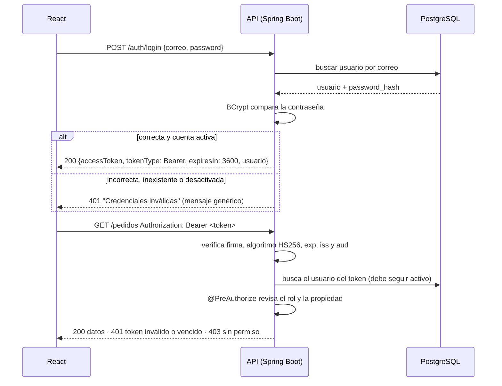

# Sonido Vivo — Backend (API REST)

API REST de la tienda de instrumentos musicales **Sonido Vivo**. Guarda el catálogo, los usuarios y los pedidos en **PostgreSQL (Amazon RDS)** y protege las rutas con **inicio de sesión JWT y roles**.

| | |
|---|---|
| **Asignatura** | DSY1104 – Desarrollo Fullstack II (2026) · Sección 005D |
| **Equipo 7** | Sebastián Fica · Alonso Valenzuela |
| **Repositorio frontend** | https://github.com/SAFD666/SonidoVivo |
| **Documentación viva (Swagger)** | `http://IP_PUBLICA_EC2:8080/swagger-ui.html` (la IP cambia al reiniciar el laboratorio) |

---

## 1. Alcance

El backend reemplaza los datos simulados del frontend (`src/data` y `localStorage`) por una base de datos real:

- **Usuarios y roles:** registro, inicio de sesión con JWT, perfil, CRUD de usuarios (Administrador).
- **Catálogo:** categorías, marcas y productos, con búsqueda, filtro por categoría y ofertas.
- **Pedidos:** compra con descuento de stock, historial del cliente, cambio de estado y cancelación con devolución de stock.
- **Ubicaciones:** regiones y comunas de Chile para la dirección de despacho.

Fuera del alcance (se mantienen en el frontend): carrito (`localStorage`), blog y formulario de contacto.

---

## 2. Decisiones técnicas

| Decisión | Elección | Justificación |
|---|---|---|
| Lenguaje y framework | **Java 21 + Spring Boot 3.5** | Spring Web, Data JPA, Validation y Security cubren API REST, acceso a datos, validación y seguridad en un mismo ecosistema. |
| Ejecución | **Amazon EC2** (Ubuntu 24.04, puerto 8080) | Un proceso siempre activo mantiene el pool de conexiones a la base (sin *cold start*, a diferencia de Lambda). |
| Base de datos | **PostgreSQL en Amazon RDS** | Datos relacionales (pedido ↔ producto) que necesitan transacciones; RDS administra respaldos y la base queda privada (*Public access: No*). |
| Acceso a datos | **Spring Data JPA / Hibernate** | Repositorios sin SQL manual; Hibernate crea las tablas desde las entidades (`ddl-auto=update`). |
| Validación | **Bean Validation** (`@NotBlank`, `@Pattern`, `@Positive`…) | El servidor vuelve a validar todo, aunque React ya lo haga. |
| Contraseñas | **BCrypt, costo 12** | Ver sección 6. |
| Tokens | **JWT HS256** con librería `jjwt` | Ver sección 6. |
| Documentación | **springdoc-openapi (Swagger UI)** | La documentación se genera del propio código y permite probar las rutas. |

---

## 3. Diseño de datos


> Diagrama en Drive: (https://drive.google.com/file/d/1LF-RZrs-NSJGT6zumSQa5icqykCRJvwD/view?usp=sharing)

**13 tablas:** `rol`, `usuario`, `region`, `comuna`, `direccion`, `marca`, `categoria`, `producto`, `estado_pedido`, `tipo_entrega`, `metodo_pago`, `pedido`, `detalle_pedido`. El SQL equivalente está en `db/01_modelo_referencia.sql`.

**Relaciones principales**
- Un **rol** tiene muchos **usuarios**; un **usuario** realiza muchos **pedidos** y registra muchas **direcciones**.
- **Región 1:N Comuna 1:N Dirección.** Un pedido tiene **0 o 1 dirección** (ninguna en *Retiro en Tienda*).
- **Pedido N:M Producto**, resuelto por **detalle_pedido**.
- **Categoría** y **marca** agrupan productos. **Estado, tipo de entrega y método de pago** son tablas de catálogo referenciadas por el pedido.

**Reglas de integridad y decisiones**
- Únicos: correo, código de producto y de pedido, slug de categoría y los nombres de cada catálogo.
- **Usuarios y productos no se borran: se desactivan** (`activo = false`) para no dejar pedidos sin dueño o sin producto. Los pedidos se **cancelan**.
- El **detalle copia código, nombre y precio** del momento de la compra, y el pedido copia el nombre y el correo del cliente: el historial no cambia si después se edita un producto o un perfil.
- `producto.version` aplica **bloqueo optimista** y la compra hace `SELECT … FOR UPDATE` para que dos ventas simultáneas no descuenten el mismo stock.
- **Datos iniciales:** al arrancar se cargan (solo si faltan) los roles, los catálogos de pedido, 16 regiones y 44 comunas, 9 categorías, 31 marcas, 50 productos, 3 cuentas demo y 2 pedidos de ejemplo, los mismos de `src/data` del frontend.

---

## 4. Organización del backend

```
React (Axios) ──HTTP/JSON──▶ controller ──▶ service ──▶ repository ──▶ PostgreSQL (RDS)
                                 │             │
                                dto          security (JWT, roles)
```

| Capa | Paquete | Responsabilidad |
|---|---|---|
| Controladores | `controller` | Reciben la solicitud, validan el DTO (`@Valid`), aplican permisos (`@PreAuthorize`) y responden con el estado HTTP. |
| Servicios | `service` | Reglas del negocio: stock, total del pedido, estados, propiedad de los datos. |
| Acceso a datos | `repository` | Interfaces `JpaRepository`; consultas por nombre de método. |
| Modelos | `model` | Entidades JPA = tablas del DER. |
| DTO | `dto` | `*Request` (lo que entra, con validaciones) y `*Response` (lo que sale, sin contraseñas). |
| Seguridad | `security`, `config` | Emisión y verificación del JWT, filtro por solicitud, BCrypt, CORS. |
| Errores | `exception` | Respuesta uniforme `{ mensaje, detalles }` para 400, 401, 403, 404, 409 y 429. |

**Responsabilidades del equipo**
- **Sebastián Fica:** estructura del proyecto, usuarios y autenticación JWT, productos y pedidos con regla de stock, README y Postman inicial.
- **Alonso Valenzuela:** ajuste del código al DER (marca, slug de categoría, catálogos de pedido, regiones/comunas/direcciones y nombres de columnas), documento del DER y conexión del frontend.

---

## 5. API

Todas las rutas van bajo `/api/v1`. En Swagger: `POST /auth/login` → copiar `accessToken` → botón **Authorize**.

| Recurso | Método y ruta | Permiso | Pantalla del frontend |
|---|---|---|---|
| Auth | `POST /auth/register` | Público (crea siempre Cliente) | Crear cuenta |
| | `POST /auth/login` | Público | Login |
| | `GET /auth/me` | Autenticado | Mi perfil |
| Usuarios | `GET /usuarios` · `POST /usuarios` | Administrador | Admin → Usuarios |
| | `GET /usuarios/{id}` · `PUT /usuarios/{id}` | Administrador o el propio usuario | Mi perfil |
| | `PATCH /usuarios/{id}/rol` · `DELETE /usuarios/{id}` · `PATCH /usuarios/{id}/reactivar` | Administrador | Admin → Usuarios |
| Categorías | `GET /categorias` · `GET /categorias/slug/{slug}` | Público | Inicio, Categorías |
| | `POST /categorias` · `PUT /categorias/{id}` | Administrador o Vendedor | Admin → Categorías |
| Marcas | `GET /marcas` | Público | Filtro de Ofertas |
| Productos | `GET /productos?categoria=&oferta=&q=` · `GET /productos/{codigo}` | Público | Catálogo, Ofertas, Detalle, búsqueda |
| | `POST /productos` · `PUT /productos/{codigo}` · `PATCH /productos/{codigo}/stock` · `DELETE /productos/{codigo}` | Administrador o Vendedor | Admin → Productos, Stock crítico |
| Ubicaciones | `GET /regiones` | Público | Checkout (Región → Comuna) |
| Pedidos | `GET /pedidos/opciones` | Público | Checkout |
| | `POST /pedidos` | Cliente | Checkout |
| | `GET /pedidos` · `GET /pedidos/{codigo}` | Cliente: solo los suyos · Admin/Vendedor: todos | Mis pedidos, Admin → Pedidos, Comprobante |
| | `PATCH /pedidos/{codigo}/estado` | Administrador o Vendedor | Admin → Pedidos |
| | `PATCH /pedidos/{codigo}/cancelar` | Dueño del pedido (solo *En preparación*) | Mis pedidos |

**Ejemplo: crear un pedido** (el servidor calcula precios, total, fecha y estado)
```json
POST /api/v1/pedidos
{
  "nombre": "Cliente Prueba",
  "telefono": "+56912345678",
  "direccion": { "calle": "Av. Libertad", "numero": "450", "depto": "", "idComuna": 8 },
  "tipoEntrega": "Despacho Starken",
  "metodoPago": "Tarjeta de débito",
  "items": [ { "codigo": "GA001", "cantidad": 1 } ]
}
```
Respuesta **201** con `id` (`PED-1003`), `fecha`, `estado: "En preparación"`, `total` e `items`. La dirección es obligatoria salvo en *Retiro en Tienda*.

**Códigos de error:** 400 datos inválidos · 401 sin token, token alterado o vencido, o credenciales incorrectas · 403 sin permiso o datos de otra persona · 404 no existe · 409 correo duplicado o stock insuficiente · 429 demasiados intentos de login.

---

## 6. Seguridad

### Contraseñas: BCrypt (costo 12)
- Es un algoritmo **lento a propósito y con sal aleatoria**: cada hash es distinto aunque dos personas usen la misma contraseña, y probar millones de combinaciones se vuelve muy costoso.
- El **costo 12** (2¹² rondas) tarda unos cientos de milisegundos por intento: imperceptible para un usuario, pero muy caro para un atacante.
- Biblioteca: `BCryptPasswordEncoder` de Spring Security. Solo se guarda `usuario.password_hash`; nunca se devuelve en la API.
- Fuentes: [OWASP Password Storage Cheat Sheet](https://cheatsheetseries.owasp.org/cheatsheets/Password_Storage_Cheat_Sheet.html) · [Spring Security – Password Storage](https://docs.spring.io/spring-security/reference/features/authentication/password-storage.html)

### Inicio de sesión con JWT



| Decisión | Valor |
|---|---|
| Emite y verifica | El backend (React nunca ve la clave) |
| Algoritmo | HS256, clave `JWT_SECRET` de 32+ caracteres en variable de entorno, fuera del repositorio |
| Campos del token | `sub` (id del usuario), `iss` (`sonido-vivo-api`), `aud` (`sonido-vivo-frontend`), `iat`, `exp` y `rol`. Sin contraseñas ni datos sensibles. |
| Vigencia | **60 minutos**: suficiente para una compra y limita el daño si el token se filtra. Sin *refresh token*: al vencer se vuelve a iniciar sesión. |
| En el frontend | El token se guarda **en memoria**; al recargar se pide login de nuevo. |
| Cerrar sesión | El frontend borra el token. Una copia ya emitida sigue siendo válida hasta su `exp`. |
| Cuenta desactivada | En **cada solicitud** se comprueba que el usuario siga activo: sus tokens dejan de servir de inmediato. |
| Intentos de login | 5 fallos → bloqueo de 5 minutos para ese correo (429). |

### Permisos
- Ocultar botones en React no basta: **cada ruta comprueba el rol en el backend** (`@PreAuthorize`).
- El **registro público siempre crea Cliente**; solo un Administrador asigna roles.
- **Datos ajenos:** un Cliente que cambia el id o el código en la URL para ver un usuario o pedido de otra persona recibe **403**.
- **CORS** solo permite el origen del frontend (`CORS_ALLOWED_ORIGINS`). CORS no reemplaza la autorización.
- En producción las credenciales y tokens deben viajar por **HTTPS**; en el laboratorio se usa HTTP con datos ficticios.

---

## 7. Cómo ejecutar

**Requisitos:** Java 21, acceso a un PostgreSQL (RDS en la misma VPC que la EC2, puerto 5432 abierto solo para el grupo de seguridad de la EC2) y el puerto 8080 abierto en la EC2.

```bash
git clone <URL_DE_ESTE_REPOSITORIO> && cd Backend_SonidoVivo
cp .env.example .env        # completar con los valores reales (no se sube a GitHub)
set -a; source .env; set +a
./mvnw spring-boot:run      # o: ./mvnw clean package -DskipTests && java -jar target/*.jar
```

| Variable | Ejemplo / descripción |
|---|---|
| `DB_URL` | `jdbc:postgresql://ENDPOINT_RDS:5432/sonidovivo?sslmode=require` |
| `DB_USER` / `DB_PASSWORD` | Usuario y contraseña de la base |
| `JWT_SECRET` | Clave aleatoria de 32 caracteres o más |
| `JWT_EXPIRATION_MINUTES` | `60` |
| `CORS_ALLOWED_ORIGINS` | URL del frontend, por ejemplo `http://localhost:5173` |
| `DEMO_PASSWORD` | Contraseña de las cuentas demo |

**Cuentas demo:** `admin@sonidovivo.cl`, `vendedor@sonidovivo.cl` y `cliente@correo.cl`, con la contraseña de `DEMO_PASSWORD`.

**Si cambia la estructura de las tablas** (datos de prueba): `DROP SCHEMA public CASCADE; CREATE SCHEMA public;` y volver a arrancar; los datos iniciales se cargan solos.

---

## 8. Pruebas realizadas (Swagger)

| Caso | Resultado obtenido |
|---|---|
| Login válido (admin, vendedor, cliente) | ✅ 200 con token de 60 min |
| Login con contraseña incorrecta | ✅ 401 mensaje genérico |
| Ruta protegida sin token | ✅ 401 |
| Cliente lista usuarios / crea categoría | ✅ 403 |
| Registro con correo repetido | ✅ 409 |
| `GET /productos`, `/categorias`, `/marcas`, `/regiones` | ✅ 50 productos, 9 categorías (con slug), 31 marcas, 16 regiones |
| `GET /productos?categoria=bajos` | ✅ Solo bajos |
| Cliente crea pedido con dirección | ✅ 201, stock descontado |
| Pedido de despacho sin dirección | ✅ 400 |
| Admin cambia estado de PED-1002 a Enviado | ✅ 200 |
| Tablas y FK en PostgreSQL (Database Client) | ✅ 13 tablas con datos iniciales |

**Pendiente:** pruebas de integración con React (carga, error y sesión vencida) y adaptar las pruebas Vitest del frontend.

---

## 9. Estado del trabajo

| Funcionalidad | Diseñado | Implementado | Probado |
|---|:-:|:-:|:-:|
| Usuarios, roles y JWT | ✅ | ✅ | ✅ |
| Catálogo (categorías, marcas, productos) | ✅ | ✅ | ✅ |
| Pedidos con regla de stock | ✅ | ✅ | ✅ |
| Regiones, comunas y direcciones | ✅ | ✅ | ✅ |
| Modelo igual al DER | ✅ | ✅ | ✅ |
| Frontend consume la API (Axios) | ✅ | ⏳ | ⏳ |

**Dificultades:** la EC2 `t3.micro` (1 GB) se quedaba sin memoria al compilar → se agregó swap de 2 GB y límites de memoria a Maven/Java. Hibernate no renombra columnas → para cambios de estructura con datos de prueba se recrea el esquema.

**Próximos pasos:** conectar el frontend (services con Axios, TiendaContext, login con token en memoria, checkout con Región → Comuna) y probar todo junto.

---

## 10. Checklist (Guía 19)

- [x] Repositorio exclusivo para el backend, separado del frontend.
- [x] README con proyecto, alcance e integrantes.
- [ ] Enlace al backend en el README del frontend.
- [x] Tecnología, ejecución en EC2 y motor de base de datos justificados.
- [x] Diagrama entidad-relación actualizado. [ ] Enlace de Drive con acceso de lectura.
- [x] Responsabilidades del backend y del equipo.
- [x] Estructura, conexión a datos y endpoints implementados.
- [x] API documentada con Swagger.
- [ ] Integración con el frontend.
- [x] Protección de contraseñas investigada y justificada.
- [x] Flujo JWT, permisos y diagrama de secuencia, con casos de rechazo.
- [x] Pruebas reales registradas y pendientes separados.
- [x] Pasos para ejecutar y comprobar.
